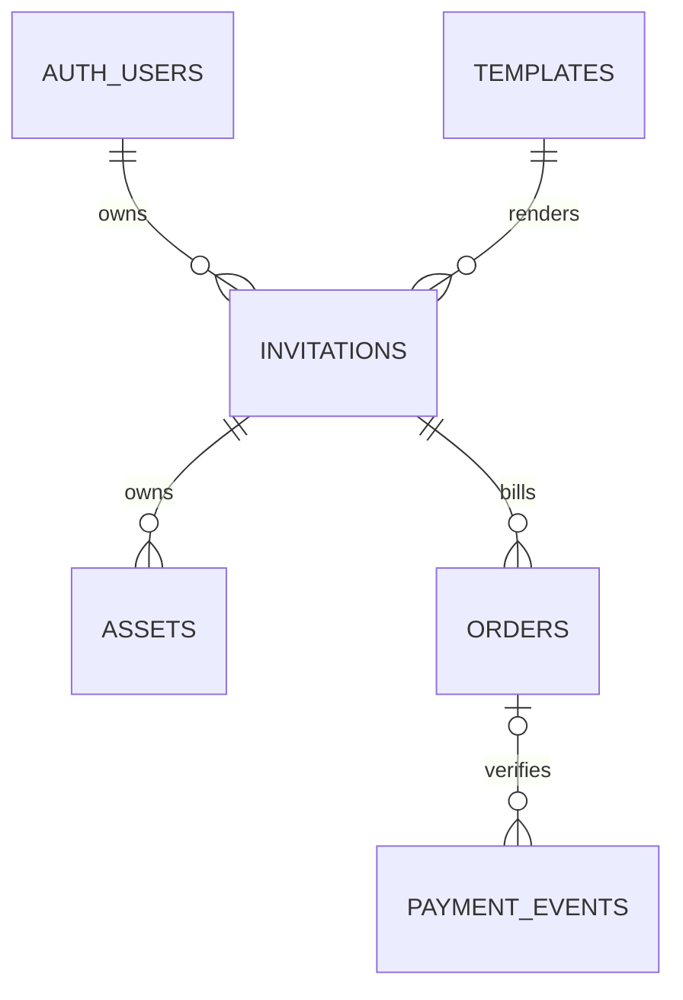

# Developer B Day 1 auth and drafts

## Route and catalogue agreement

This platform contract uses the route shapes proposed in [storefront v0.1](../storefront/route-catalogue-contract-v0.1.md). Afterglow is the registered design. Heirloom is its cover and alternate demo URL. A separate product requires a registered design and an approved price.

| Route                | Contract                                                                      |
| -------------------- | ----------------------------------------------------------------------------- |
| `/sign-in`           | Sign in with a pre-provisioned Supabase account and return to a studio route. |
| `/create/[template]` | Reserved for authenticated draft creation. The template must be active.       |
| `/studio`            | Protected account entry for Day 1 verification.                               |
| `/studio/[id]`       | Reserved for an owner-scoped editor. Day 1 authenticates and returns 404.     |
| `/checkout/[id]`     | Reserved for checkout using server-authoritative pricing and order snapshots. |
| `/i/[slug]`          | Reserved for the published invitation projection after verified payment.      |

`public.templates` owns availability, currency and price. An active row requires a positive integer INR price in paise. The migration seeds Afterglow as demo-only with a null price. Storefront metadata continues to link to the demo. Business approval of the price and Developer A’s review are pending.

## Data model and access



- `invitations.data` stores the [canonical invitation payload](../invitation-schema.md) with `schema_version = 1`. The database enforces the JSON object envelope. The application must use the canonical Zod parser when creating, loading, saving or publishing data. The `version` column is the optimistic concurrency token. A save must scope the update to the current owner, draft ID and expected version, and treat a zero-row update as a failed save.
- Draft owners can read their invitations and edit draft content. The database derives the owner on insert. Owner, template, schema version, payment state, share slug and the optimistic version are outside the authenticated write grants. User accounts can read their own asset metadata. Server-side upload authorization and access to file bytes belong to Day 4.
- The lifecycle is `draft → payment_pending → paid → published`. Pending may return to draft after cancellation. Paid and published invitations may be revoked. Moving to paid or published requires a captured order. Order IDs, payment IDs, event IDs and share slugs are unique. Orders record the price snapshot and verification timestamp. Order and event writes are server-only.
- The public lookup returns renderer inputs by share slug only while the invitation is published and has a captured order. It exposes the registry key, schema version, share slug, publication time and published payload. Checkout and webhook verification, fulfillment and the public route are future work.

## Setup and verification

1. Apply the versioned migration to an empty or approved scratch Supabase database. Use the project’s existing migration workflow if it has one. The following commands exercise PostgreSQL through its connection string, set in the environment outside the repository.

   ```sh
   psql "$SUPABASE_TEST_DB_URL" -v ON_ERROR_STOP=1 --single-transaction -f supabase/migrations/20261119000000_auth_drafts.sql
   psql "$SUPABASE_TEST_DB_URL" -v ON_ERROR_STOP=1 -f supabase/tests/auth_drafts.sql
   ```

   The test transaction rolls back its two fictional users, temporary amount, draft, asset and payment records. The hosted execution requires a database role that can create fixtures and assume the Supabase API roles.

2. Set `SUPABASE_URL` and `SUPABASE_PUBLISHABLE_KEY` from the test project in an ignored `.env.local`. Use the `sb_publishable_` key. No elevated Supabase secret is required by the app.
3. In the test project, provision two confirmed password test accounts. Run the app and open `/studio` anonymously. Follow the redirect, sign in, reload the studio and sign out. Confirm that opening `/studio` again redirects to sign-in. Repeat in a separate browser context for the second test account. Confirm that a direct visit to a draft URL also requires authentication.

Local SQL ran twice on PostgreSQL WASM with Supabase roles and fixture implementations of `auth.uid()` and `auth.jwt()`. The assertions cover cross-account and anonymous draft isolation, purchase-state restrictions, optimistic version checks, owner-only asset metadata, event deduplication, public projection and refund withdrawal.

The production build passed Chrome checks against a local Auth test double for missing configuration, unauthenticated redirects, invalid and valid credentials, session refresh, HTTP-only secure cookies and sign-out. The hosted Supabase sign-in and migration are pending.

For a disposable database with no customer data, rollback consists of dropping `get_published_invitation(text)`, then `payment_events`, `orders`, `assets`, `invitations`, `templates` and the `yugma_private` schema in dependency order. Use a reviewed forward migration or a verified backup once data exists.

## Dependency and account status

| Check                 | Day 1 observation                                                                                                                                                                               |
| --------------------- | ----------------------------------------------------------------------------------------------------------------------------------------------------------------------------------------------- |
| Runtime audit         | The pre-change lockfile reported one affected runtime package, Next.js 16.4.3. The 16.4.6 patch and the matching ESLint config are installed. `npm audit --omit=dev` now reports zero findings. |
| Development audit     | Seven moderate findings remain in the TypeScript ESLint dependency chain through `minimatch`. Keep this tracked as development tooling maintenance.                                             |
| Supabase test project | Hosted project, migration, provisioned accounts and actual sign-in still require confirmation.                                                                                                  |
| Email delivery        | Unverified. Day 1 uses pre-provisioned password accounts.                                                                                                                                       |
| Hosting and domain    | GitHub returned no deployment records. Staging host and production domain require confirmation.                                                                                                 |
| Razorpay              | Test account access and live merchant approval, credentials and settlement status require confirmation. No gateway configuration was used.                                                      |

The roadmap mentions 18 findings. This checkout's initial full audit reported eight moderate findings, including Next.js. The current audit reflects the committed lockfile and registry response.
